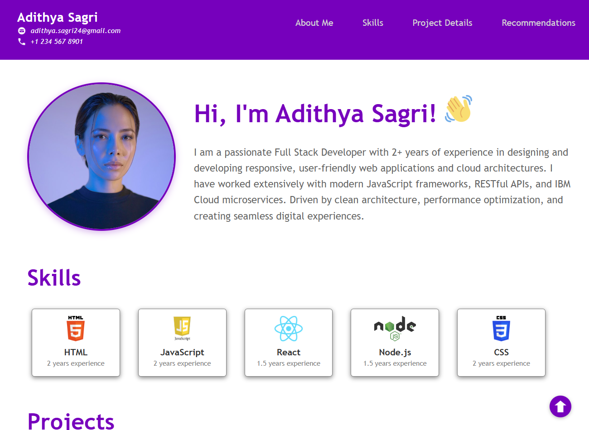
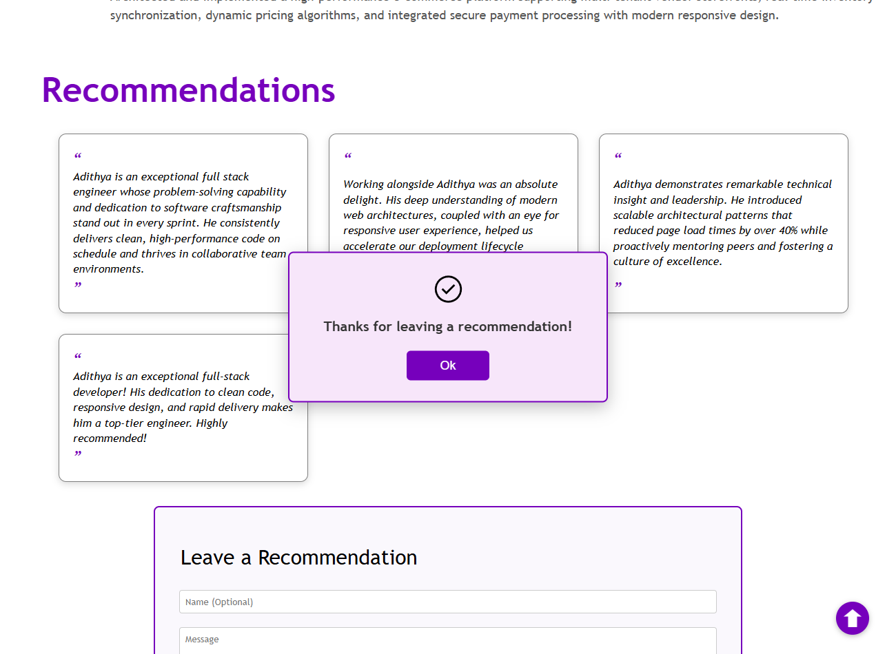

# Adithya Sagri - Developer Portfolio Website

A clean, responsive, and modern personal portfolio website built with semantic HTML5, CSS3, and JavaScript. Developed as part of the Coursera / IBM Full Stack & Web Development Final Project.

---

## 🌟 Live Demo & Repository

- **GitHub Repository**: [https://github.com/Adithya-sagri24/S](https://github.com/Adithya-sagri24/S)
- **GitHub Pages**: [https://adithya-sagri24.github.io/S/](https://adithya-sagri24.github.io/S/) *(enable via Settings > Pages)*

---

## 🚀 Key Features

1. **Navigation Bar**:
   - Displays developer name with email and phone contact details.
   - Smooth navigation links to **About Me**, **Skills**, **Project Details**, and **Recommendations**.
2. **About Me**:
   - Engaging introduction with professional profile avatar and welcoming greeting.
3. **Skills Showcase**:
   - Visual display cards with authentic logos for **HTML5**, **JavaScript**, **React**, **Node.js**, and **CSS3**, along with years of experience.
4. **Featured Projects**:
   - Detailed project portfolio cards highlighting key technical accomplishments, architecture, and impacts.
5. **Dynamic Recommendation Engine**:
   - Interactive recommendation list with stylized quotes.
   - "Leave a Recommendation" submission form.
   - Interactive modal pop-up confirmation when a user posts a recommendation without page reload.
6. **Quick Return-to-Top**:
   - Floating action button to instantly scroll back to the home view.

---

## 📸 Screenshots

| Navigation, Profile & Skills Showcase | Recommendation Modal & Dynamic Addition |
| :---: | :---: |
|  |  |

---

## 🛠️ Built With

- **HTML5**: Semantic tags, accessible landmarks, and clean structure.
- **CSS3**: Responsive flexbox layout, media queries, animations, and custom styling.
- **JavaScript (ES6)**: DOM manipulation, event listeners, and interactive popup state handling.

---

## 📂 Project Structure

```text
├── html_finalprojimages/      # Icons, technology logos, and graphics
├── index.html                 # Main website markup
├── style.css                  # Core CSS styling and responsive layout
├── script.js                  # Dynamic recommendation and modal logic
├── functionality.png          # Screenshot: Nav, About Me & 5 Skills
├── new_recommendation.png     # Screenshot: Recommendation popup dialog
├── take_screenshots.js        # Automated screenshot verification script
└── README.md                  # Project overview and documentation
```

---

## 💻 How to Run Locally

1. Clone the repository:
   ```bash
   git clone https://github.com/Adithya-sagri24/S.git
   cd S
   ```
2. Open `index.html` in any modern web browser:
   - Double click `index.html`, or
   - Use VS Code Live Server extension, or run `npx serve .`

---

## 👤 Author

**Adithya Sagri**  
- Email: [adithya.sagri24@gmail.com](mailto:adithya.sagri24@gmail.com)  
- GitHub: [@Adithya-sagri24](https://github.com/Adithya-sagri24)
